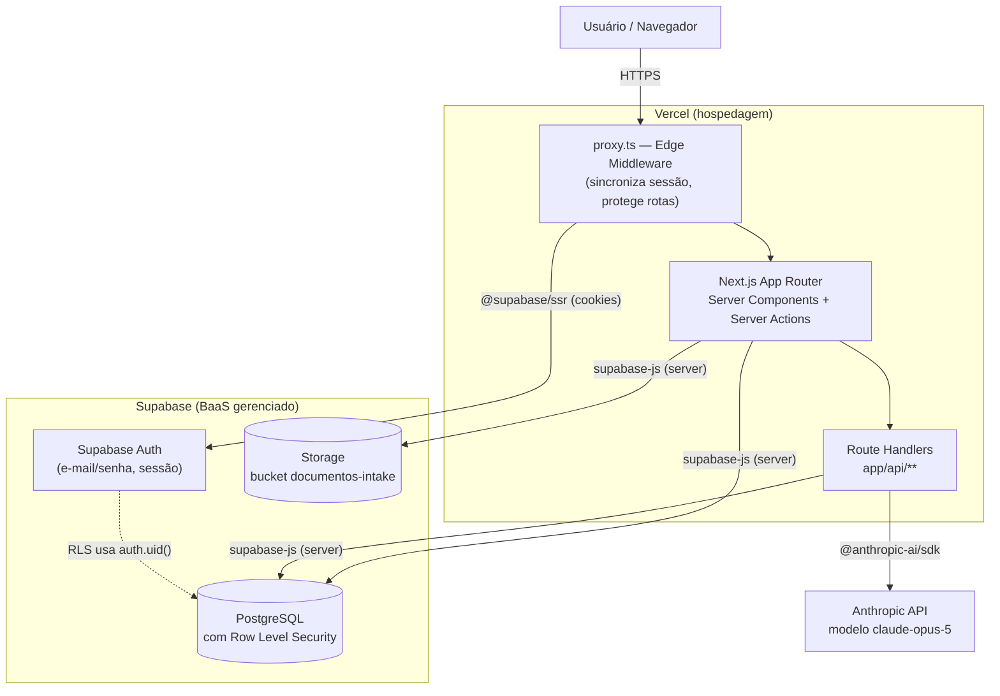

# ValuM&A — Arquitetura da Solução

Documento complementar a `docs/PACOTE_MONOGRAFIA_TCC.md` (seção 5). Diagrama e explicação refletem a implantação real, confirmada em produção (`https://valuma.vercel.app`), não um modelo idealizado.

## Diagrama (Mermaid)

## Papel de cada camada

**Usuário/Navegador** — client puro: HTML/CSS/JS entregue pelo Next.js, mais os Client Components interativos (formulários, chat). Não guarda nenhum segredo (a chave da Anthropic nunca chega ao navegador).

**proxy.ts (Edge Middleware)** — convenção do Next.js 16 (substituiu `middleware.ts` em versões anteriores). Roda antes de qualquer página, em toda requisição que não seja arquivo estático: sincroniza o cookie de sessão do Supabase e redireciona para `/login` se a rota for protegida (`/dashboard`, `/intake`, `/processos`) e não houver sessão válida. Implementado em `lib/supabase/middleware.ts::updateSession`.

**Next.js App Router (Server Components + Server Actions)** — a maior parte do sistema. Páginas como o Dashboard, cada etapa do intake e a tela de Resultado são Server Components: buscam dados diretamente do Supabase a cada requisição, usando a sessão do usuário atual, e renderizam HTML já populado (sem round-trip extra de "carregando..."). Mutações mais simples (excluir processo, atualizar nome, sincronizar sócios) usam Server Actions (`"use server"`), chamadas diretamente de formulários/botões do cliente sem precisar de uma rota de API explícita.

**Route Handlers (`app/api/**`)** — usados onde a operação é mais pesada, assíncrona ou precisa de streaming: gerar resultado (orquestra cálculo + IA + gravação), chat do assistente (streaming de texto) e geração do modelo de planilha Excel.

**Supabase Auth** — autentica o usuário (e-mail/senha) e emite a sessão. Nenhuma lógica de autorização por papel/perfil existe aqui ou em qualquer outra camada — só "autenticado" ou "não autenticado", e "dono do recurso" ou não (garantido pelo RLS abaixo).

**PostgreSQL com Row Level Security** — fonte única de verdade dos dados estruturados (usuários, processos, sócios, intake, resultados). O RLS compara `auth.uid()` (identidade da sessão atual, resolvida pelo próprio Postgres a partir do JWT da requisição) com o dono de cada linha, em toda política de select/insert/update/delete — o isolamento entre usuários não depende de nenhum filtro manual no código da aplicação.

**Storage** — arquivos binários da etapa Documentos, num bucket privado, com o mesmo padrão de isolamento por dono (via caminho do arquivo, que começa com o `processo_id`).

**Anthropic API** — único serviço de IA do sistema, chamado exclusivamente a partir de Route Handlers (nunca do navegador). Usada em dois pontos: geração da Análise Estratégica (`lib/ai/analisar.ts`, chamada síncrona dentro da geração de resultado) e o assistente conversacional (`lib/ai/chat-assistente.ts`, resposta em streaming). Em ambos os casos, a IA só recebe números já calculados pelo motor determinístico como contexto de leitura — nunca os calcula.

## Observações de implementação

- Não há backend separado do frontend: é uma única aplicação Next.js, o que simplifica o deploy (um só serviço no Vercel) mas significa que toda a lógica de servidor compartilha o mesmo runtime das páginas.
- Não há camada de cache/fila própria — cada requisição busca os dados diretamente no Postgres; o único "cache" é o `revalidatePath` do Next.js para invalidar a página do Dashboard depois de uma Server Action.
- A dependência do Supabase é estrutural (sem fallback): se o Supabase ficar indisponível, toda a aplicação fica indisponível, já que até a verificação de sessão em `proxy.ts` depende dele. A dependência da Anthropic, por outro lado, é tolerante a falha (RNF-07 em `docs/REQUISITOS_FUNCIONAIS_NAO_FUNCIONAIS.md`).
