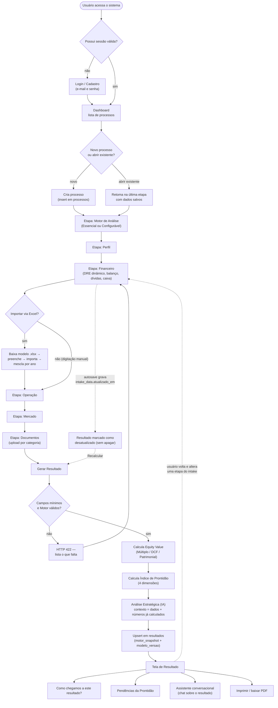

# ValuM&A — Fluxograma Funcional

Documento complementar a `docs/PACOTE_MONOGRAFIA_TCC.md` (seção 6). Cobre apenas comportamentos realmente implementados, confirmados por leitura do código.

## Fluxograma principal (Mermaid)

## Observações sobre o fluxo

- **Autosave em toda etapa do intake:** não há um botão "salvar" — cada formulário grava automaticamente 1,5s após a última alteração (`useAutosave`). O fluxograma omite essa gravação em cada caixa de etapa por clareza visual, mas ela ocorre em todas (Motor, Perfil, Financeiro, Operação, Mercado, Documentos).
- **A importação por Excel é opcional e não substitui a etapa Financeiro** — ela só preenche o mesmo formulário que o preenchimento manual preencheria, mesclando por ano; o usuário pode misturar os dois métodos livremente no mesmo processo.
- **"Gerar Resultado" não é bloqueado pela Prontidão incompleta** — só pelos campos mínimos (RG-40 de `docs/REGRAS_NEGOCIO_VALUMA_V1.md`) e pela validade da configuração do Motor. É possível (e esperado) gerar um resultado com a Prontidão longe de 100%.
- **Mesmo sem nenhum método de valuation aplicável** (EBITDA ≤ 0 e Patrimônio Líquido ≤ 0 simultaneamente), o fluxo de geração de resultado não para — ele produz um resultado parcial (Prontidão + Análise Estratégica, sem o número de Equity Value). Omitido do diagrama por clareza, mas é um estado de negócio explicitamente válido (RG-25/RG-26 da v1.0).
- **Voltar e alterar uma etapa do intake depois de já ter um resultado** não apaga nada — apenas marca o resultado existente como desatualizado (comparação de timestamps), oferecendo "Recalcular" sem forçá-lo.
