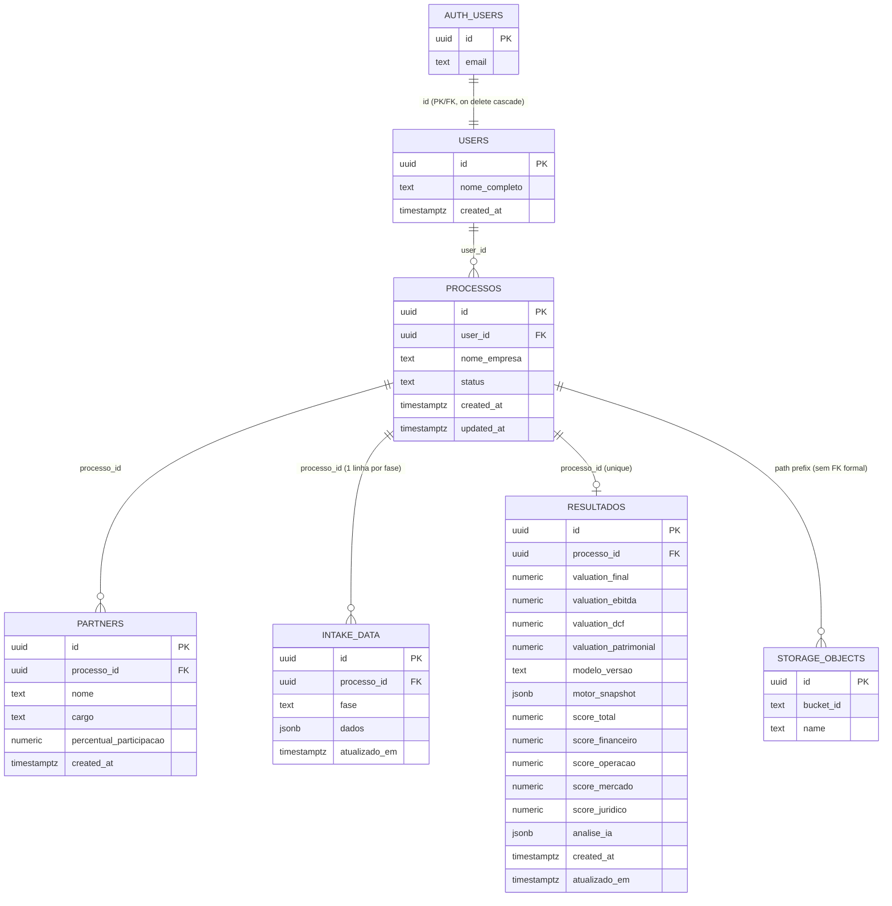

# ValuM&A — Modelo de Banco de Dados (DER)

Documento complementar a `docs/PACOTE_MONOGRAFIA_TCC.md` (seção 4). Levantado por leitura direta de `supabase/schema.sql` — reflete o banco real (incluindo todas as migrações incrementais já aplicadas), não um modelo idealizado.

## Diagrama entidade-relacionamento (Mermaid)

> `PROCESSOS ||--o| RESULTADOS` indica cardinalidade 1:0..1 (um processo pode não ter nenhum resultado ainda, mas nunca tem mais de um — `resultados_processo_id_key unique (processo_id)`). `AUTH_USERS ||--|| USERS` é 1:1 obrigatório (toda linha de `public.users` existe por causa de uma linha correspondente em `auth.users`, criada por trigger). A relação com `STORAGE_OBJECTS` não é uma FK de banco de dados de verdade (Storage não é uma tabela Postgres comum) — é um relacionamento lógico via o primeiro segmento do caminho do arquivo.

## Tabelas

### `auth.users` (gerenciada pelo Supabase Auth)
Tabela interna do Supabase, fora do controle direto da aplicação — armazena credenciais, e-mail e metadados de autenticação (`raw_user_meta_data`, usado para extrair `full_name` no cadastro). Não é editada diretamente pelo código da aplicação.

### `public.users`
**Função:** perfil público, 1:1 com `auth.users`.
**PK:** `id` (também FK para `auth.users.id`, `on delete cascade`).
**Campos:** `nome_completo` (text, editável), `created_at`.
**Criação:** automática, por trigger `on_auth_user_created` (`security definer`) disparado após todo `insert` em `auth.users` — o usuário nunca precisa (nem consegue) criar essa linha manualmente.
**RLS:** `users_select_own`/`users_update_own` — só o próprio usuário (`id = auth.uid()`) lê/edita sua linha. Não há `delete` policy própria (a exclusão acontece via cascade quando `auth.users` é apagado) nem `insert` policy de usuário comum (só o trigger `security definer` insere).

### `public.processos`
**Função:** um processo de valuation/M&A para uma empresa, pertencente a um usuário.
**PK:** `id` (`gen_random_uuid()`).
**FK:** `user_id` → `public.users.id` (`on delete cascade`).
**Campos principais:** `nome_empresa`, `status` (`em_andamento | concluido | arquivado`), `created_at`, `updated_at` (mantido por trigger `set_processos_updated_at`).
**Índice:** `processos_user_id_idx` em `user_id`.
**RLS:** select/insert/update/delete, todas comparando `user_id = auth.uid()` diretamente.

### `public.partners`
**Função:** sócios da empresa avaliada em um processo.
**PK:** `id`.
**FK:** `processo_id` → `public.processos.id` (`on delete cascade`).
**Campos:** `nome`, `cargo` (adicionado por migração incremental, nullable para compatibilidade com linhas antigas), `percentual_participacao`, `created_at`.
**Índice:** `partners_processo_id_idx`.
**RLS:** select/insert/update/delete, todas via `exists (select 1 from processos where id = partners.processo_id and user_id = auth.uid())` — não há coluna `user_id` própria nesta tabela, o dono é sempre resolvido através do processo pai.

### `public.intake_data`
**Função:** respostas do formulário de intake — uma linha por fase por processo (upsert = autosave).
**PK:** `id`.
**FK:** `processo_id` → `public.processos.id` (`on delete cascade`).
**Constraint única:** `intake_data_processo_fase_key unique (processo_id, fase)` — garante exatamente uma linha por fase por processo.
**Check constraint:** `fase in ('motor', 'perfil', 'financeiro', 'operacao', 'mercado', 'documentos')` — recriado (não só alterado) quando a fase `'motor'` foi adicionada na V2, porque o Postgres não permite alterar um check constraint existente diretamente.
**Campos:** `dados` (jsonb genérico — o schema específico de cada fase vive no código TypeScript, `lib/intake/schema-*.ts`, não no banco), `atualizado_em` (mantido por trigger `set_intake_data_atualizado_em`, usado para detectar resultado desatualizado).
**Índice:** `intake_data_processo_id_idx`.
**RLS:** mesmo padrão de `partners`, via `exists (... processos ... user_id = auth.uid())`.

### `public.resultados`
**Função:** resultado consolidado (valuation + Índice de Prontidão + Análise Estratégica) de um processo — um por `processo_id`, upsert a cada geração (não é um histórico de versões).
**PK:** `id`.
**FK + única:** `processo_id` → `public.processos.id` (`on delete cascade`), `resultados_processo_id_key unique (processo_id)`.
**Campos de valuation:** `valuation_final`, `valuation_ebitda`, `valuation_dcf`, `valuation_patrimonial` — todos `numeric`, **nullable** (migração da v1.0: `null` representa "método/consolidado não aplicável", nunca confundido com `0`, que é uma estimativa real).
**Campos de versionamento (independentes entre si e do jsonb de IA):**
  - `modelo_versao` (text, nullable) — versão da regra de negócio que gerou o resultado (`"valu_ma_v2"` atualmente; `null` ou `"valu_ma_v1"` = legado).
  - `motor_snapshot` (jsonb, nullable) — `{tipo, configuracao}` do Motor de Análise efetivamente usado nesta geração (V2); `null` = resultado anterior ao Motor de Análise, tratado como Motor Essencial.
**Campos de Prontidão:** `score_total`, `score_financeiro`, `score_operacao`, `score_mercado`, `score_juridico` (nomes de coluna herdados de uma versão anterior do produto — representam hoje as 4 dimensões do Índice de Prontidão: Financeiro, Operacional, Mercado, Documental).
**Campo de IA:** `analise_ia` (jsonb) — `{pontosFortes, riscos, recomendacoes, erro?, explicabilidade?}`. Não contém mais a versão do modelo (removida daqui por decisão explícita de design — ver comentário na própria coluna no schema).
**Timestamps:** `created_at` (nunca atualizado depois do insert original), `atualizado_em` (mantido por trigger `set_resultados_atualizado_em`, é o que de fato se compara com `intake_data.atualizado_em` para detectar resultado desatualizado — `created_at` não serviria, pois um upsert não o altera).
**RLS:** mesmo padrão de `partners`/`intake_data`, via `exists (... processos ... user_id = auth.uid())`.

### `storage.objects` (bucket `documentos-intake`)
**Função:** arquivos enviados na etapa Documentos do intake.
**Configuração do bucket:** privado (`public: false`), `file_size_limit` de 20 MB, `allowed_mime_types` restrito a PDF, Word, Excel, JPEG e PNG.
**Caminho de cada objeto:** `{processo_id}/{uuid}-{nome_arquivo}` — o primeiro segmento do caminho (`storage.foldername(name)[1]`) é o que toda policy usa para resolver o processo e confirmar o dono.
**RLS:** select/insert/update/delete, todas via `exists (select 1 from processos where id::text = (storage.foldername(name))[1] and user_id = auth.uid())`.

## Triggers

| Trigger | Tabela | Função | Propósito |
|---|---|---|---|
| `set_processos_updated_at` | `processos` | `set_updated_at()` | Mantém `updated_at` sempre atual em qualquer update. |
| `set_intake_data_atualizado_em` | `intake_data` | `set_atualizado_em()` | Mantém `atualizado_em` sempre atual — usado para detectar resultado desatualizado. |
| `set_resultados_atualizado_em` | `resultados` | `set_atualizado_em()` | Idem, do lado do resultado. |
| `on_auth_user_created` | `auth.users` (after insert) | `handle_new_user()` (`security definer`) | Cria automaticamente a linha correspondente em `public.users` no cadastro. |

## Observações sobre o modelo

- **Design deliberadamente jsonb-first no intake:** `intake_data.dados` é um jsonb genérico, não uma tabela normalizada por campo. Isso evita uma migração de banco a cada campo novo de formulário — o preço é que a validação de estrutura (quais campos existem, quais são obrigatórios) vive inteiramente no código TypeScript (`lib/intake/schema-*.ts`), não em constraints do banco.
- **`resultados` não é um histórico:** é um upsert por `processo_id` — gerar um novo resultado substitui o anterior. Não existe, no banco, uma tabela de histórico de resultados por processo.
- **Nenhuma tabela tem coluna de papel/perfil de usuário** — reforça o que a seção 7 de `docs/PACOTE_MONOGRAFIA_TCC.md` já descreve: não existe multi-perfil no sistema.
