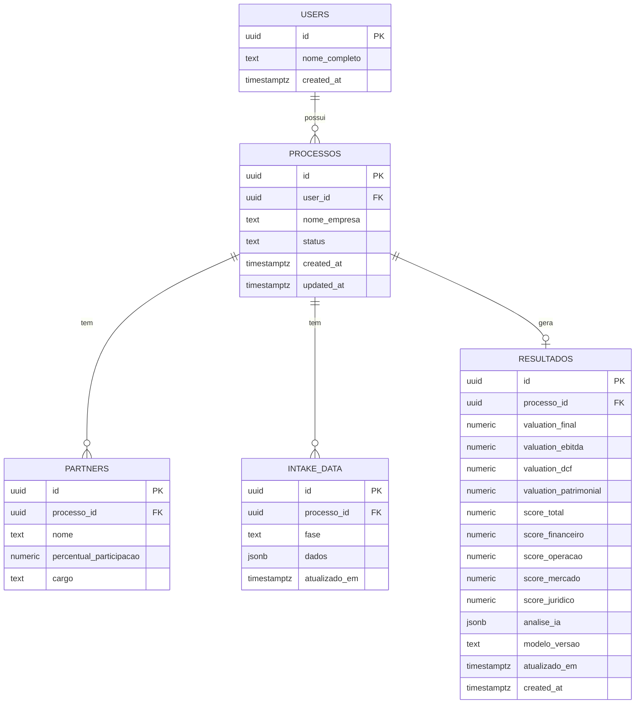

# Pacote Técnico para a Monografia — ValuM&A

Documento de evidências técnicas para uso na redação final do TCC II. Todo o conteúdo abaixo foi extraído diretamente do código-fonte, do schema do banco, do histórico Git e dos scripts de teste executados nesta sessão de trabalho (repositório `JFO05/valuma`, branch `main`). Nenhuma informação foi suposta. Onde o repositório não permite responder com segurança, isso é marcado explicitamente como **NÃO COMPROVADO / PRECISA DE INFORMAÇÃO DA EQUIPE**.

Esta rodada não alterou código, banco, regras de negócio ou interface — é um trabalho exclusivamente de levantamento e documentação.

---

## 0. Arquivos existentes em `/docs`

```
docs/PLANO_EVOLUCAO_MVP.md
docs/DECISOES_MVP.md
docs/AUDITORIA_REGRAS_NEGOCIO.md
docs/ANALISE_IMPACTO_DECISOES_V1.md
docs/ANALISE_IMPACTO_REGRAS_V1.0.md
docs/PLANO_IMPLEMENTACAO_V1.0.md
docs/REGRAS_NEGOCIO_VALUMA_V1.md
docs/IMPLEMENTACAO_REGRAS_V1.md
docs/REGRAS_NEGOCIO_VALUMA_V2.md
```

`REGRAS_NEGOCIO_VALUMA_V2.md` foi adicionado depois da escrita original deste documento (ver seção 8-A) — estende a v1.0 (RG-57 a RG-71), não a substitui.

Os três arquivos pedidos (`REGRAS_NEGOCIO_VALUMA_V1.md`, `AUDITORIA_REGRAS_NEGOCIO.md`, `IMPLEMENTACAO_REGRAS_V1.md`) existem com o nome exato solicitado e foram reproduzidos na íntegra, sem resumo, na mensagem do chat que precede este documento.

Dois arquivos adicionais relevantes, fora de `/docs`, encontrados no repositório: `README.md` (raiz) e `DESIGN.md` (raiz, não versionado/`??` no Git — ver seção 16).

---

## 1. Estado atual do produto

O ValuM&A é uma aplicação web (Next.js, autenticação própria) que conduz o usuário por um fluxo linear de coleta de dados de uma empresa e produz, ao final, uma análise preliminar estruturada em três partes: uma estimativa de Equity Value, um Índice de Prontidão Informacional e uma análise qualitativa gerada por IA.

**Fluxo completo, confirmado por leitura do código de rotas (`app/`):**

1. **Autenticação** — cadastro (`app/(auth)/signup/page.tsx`) e login (`app/(auth)/login/page.tsx`) por e-mail/senha via Supabase Auth; confirmação de e-mail (`app/(auth)/verify-email/page.tsx`, `app/auth/callback/route.ts`); recuperação de senha (`forgot-password/page.tsx`, `reset-password/page.tsx`). Rotas `/dashboard`, `/intake` e `/processos` são protegidas por `lib/supabase/middleware.ts` (lista `PROTECTED_PATHS`), que redireciona para `/login` quando não há sessão.
2. **Dashboard** (`app/(app)/dashboard/page.tsx`) — lista os processos do usuário autenticado (`public.processos`, filtrado por `user_id`), com ação "Nova avaliação" e, por processo, status, última atualização, indicação de Prontidão e indicação de resultado desatualizado.
3. **Criação de processo** (`app/(app)/intake/page.tsx`, `app/(app)/intake/actions.ts`) — cria uma linha em `public.processos` e redireciona para a primeira fase do intake.
4. **Intake em 5 fases fixas** (`app/(app)/intake/[processoId]/[fase]/page.tsx`, fases definidas em `lib/intake/fases.ts`): **Perfil** → **Financeiro** → **Operação** → **Mercado** → **Documentos**. Cada fase é salva como uma linha `jsonb` independente em `public.intake_data` (uma por `processo_id` + `fase`), com autosave debounced (`lib/hooks/useAutosave.ts`, 1.500 ms de debounce, timeout de 10.000 ms).
5. **Geração do resultado** (`app/api/processos/[processoId]/gerar-resultado/route.ts`) — ao clicar em "Gerar Resultado", a rota: (a) consolida os dados do intake (`lib/valuation/consolidar.ts`), (b) verifica os campos mínimos (`lib/valuation/campos-obrigatorios.ts`), (c) calcula o valuation (`lib/valuation/calcular.ts`), (d) calcula o Índice de Prontidão (`lib/prontidao/checklist.ts`), (e) chama a IA para a análise qualitativa (`lib/ai/analisar.ts`), e (f) persiste tudo em `public.resultados` via upsert.
6. **Tela de resultado** (`app/(app)/processos/[processoId]/resultado/page.tsx`) — exibe, nesta ordem: Equity Value, Índice de Prontidão, pendências/alertas, explicabilidade ("Como chegamos a este resultado"), análise de IA, próximas etapas profissionais, disclaimer.
7. **Recálculo** — o mesmo endpoint de geração é reutilizado; a tela compara `resultados.atualizado_em` com o `MAX(intake_data.atualizado_em)` do processo para sinalizar "resultado desatualizado" e oferecer recalcular.
8. **Impressão/PDF** (`components/resultado/baixar-pdf-button.tsx`) — aciona `window.print()` sobre a própria tela de resultado já renderizada; não existe geração de PDF server-side nem biblioteca dedicada.

Este fluxo é consistente com o que está descrito em `docs/IMPLEMENTACAO_REGRAS_V1.md` e foi exercido ponta a ponta nesta sessão via automação de navegador real (Playwright) contra o servidor de desenvolvimento e o banco Supabase real — ver seção 9.

---

## 2. Stack real

Extraído de `package.json` e arquivos de configuração na raiz do repositório.

| Categoria | Tecnologia | Função no projeto |
|---|---|---|
| Linguagem | TypeScript (`^5`) | Linguagem de todo o código de aplicação (`.ts`/`.tsx`); `strict` conforme `tsconfig.json`. |
| Framework | Next.js `16.3.4` (App Router) | Framework full-stack: roteamento por pastas (`app/`), Server Components, Route Handlers (API), Server Actions. |
| Frontend | React `19.2.8` / React DOM `19.2.8` | Biblioteca de UI usada pelo Next.js. |
| Backend/API | Route Handlers do Next.js (`app/api/**/route.ts`) | Único endpoint de API HTTP no projeto: geração de resultado. Toda a demais leitura/escrita de dados ocorre via Server Components/Server Actions chamando o SDK do Supabase diretamente (sem uma camada de API REST própria). |
| Banco de dados | Supabase (Postgres) | Hospeda todas as tabelas da aplicação (`public.*`) — ver seção 4. |
| Autenticação | Supabase Auth (`@supabase/ssr` `^0.12.5`, `@supabase/supabase-js` `^2.112.4`) | Cadastro/login por e-mail e senha, sessão via cookies HTTP, sincronizada em cada request pelo middleware. |
| Storage | Supabase Storage, bucket `documentos-intake` | Armazena os arquivos enviados na etapa Documentos do intake. |
| Hospedagem/deploy | Vercel | Confirmado por `.vercel/project.json` (`projectName: "valuma"`) e pela seção "Deploy" do `README.md`. **NÃO COMPROVADO**: URL de produção, se o deploy está atualmente ativo/publicado, e se o deploy é automático a cada push — nenhum desses três fatos está registrado no repositório. |
| Form handling | `react-hook-form` `^7.87.0`, `@hookform/resolvers` `^5.9.1` | Gerencia estado e validação dos 4 formulários de intake com schema Zod (Perfil, Financeiro, Operação, Mercado). |
| Validação | `zod` `^3.25.76` | Define os schemas de dados de cada fase do intake (`lib/intake/schema-*.ts`) e o schema de saída estruturada da IA (`zodOutputFormat`). |
| Integração com IA | `@anthropic-ai/sdk` `^0.125.0` | Cliente da API da Anthropic. Modelo usado: `claude-opus-5` (constante `MODEL` em `lib/ai/analisar.ts:34`). Chamada com `zodOutputFormat(analiseIaSchema)` para forçar saída estruturada (JSON validado por schema), não por instrução textual livre. |
| Estilo | Tailwind CSS `^4`, `@tailwindcss/postcss` `^4` | CSS utilitário, configuração "CSS-first" (`app/globals.css`, diretivas `@theme inline`). |
| Qualidade de código | ESLint `^9`, `eslint-config-next` | Lint do projeto (`npm run lint`). |
| Execução de scripts TS | `tsx` `^4.23.13` | Executa os scripts de teste (`scripts/testar-*.ts`) sem necessidade de build. |

**NÃO COMPROVADO** pelo repositório: provedor de e-mail transacional usado pelo Supabase Auth (confirmação de cadastro, recuperação de senha) — é configuração do painel Supabase, não do código.

---

## 3. Arquitetura

### Camadas

- **Browser/cliente**: React Server/Client Components renderizados pelo Next.js; formulários de intake são Client Components (`"use client"`) por dependerem de estado local e autosave; a maior parte das páginas de leitura (dashboard, resultado) são Server Components que buscam dados diretamente do Supabase no servidor.
- **Next.js (App Router)**: roteamento por convenção de pastas em `app/`; dois grupos de rotas — `(auth)` (público: login/signup/recuperação) e `(app)` (protegido: dashboard/intake/processos), cada grupo com seu próprio `layout.tsx`.
- **Rotas/API**: apenas uma rota de API HTTP própria (`app/api/processos/[processoId]/gerar-resultado/route.ts`, método `POST`); toda a leitura e a maior parte da escrita de dados passam pelo SDK do Supabase chamado diretamente de Server Components/Server Actions (ex.: `app/(app)/dashboard/actions.ts::excluirProcesso`), não por uma API REST própria intermediária.
- **Supabase**: Postgres (dados relacionais/jsonb), Auth (sessão e identidade), Storage (arquivos).
- **RLS (Row Level Security)**: habilitada em todas as tabelas de aplicação (`users`, `processos`, `partners`, `intake_data`, `resultados`) e no bucket de Storage — o isolamento entre usuários é garantido no nível do banco, não apenas na aplicação (ver seção 11).
- **Serviço de IA**: chamada HTTP para a API da Anthropic (`lib/ai/analisar.ts`), feita a partir do servidor (dentro da rota de geração de resultado) — nunca do navegador.
- **Motor determinístico de valuation**: `lib/valuation/calcular.ts` — funções puras (sem I/O), recebem os dados já consolidados do processo e devolvem os valores calculados.
- **Motor de Prontidão**: `lib/prontidao/checklist.ts` — também funções puras, recebem os mesmos dados consolidados e devolvem o Índice de Prontidão.

### O que é determinístico × o que depende de serviço externo

| Cálculo | Determinístico (local, sem rede) | Depende de serviço externo |
|---|---|---|
| Valuation (Múltiplos, DCF simplificado, Patrimonial, consolidado) | ✅ `lib/valuation/calcular.ts` | — |
| Índice de Prontidão Informacional | ✅ `lib/prontidao/checklist.ts` | — |
| Verificação de campos mínimos | ✅ `lib/valuation/campos-obrigatorios.ts` | — |
| Persistência do resultado | — | Supabase Postgres |
| Análise qualitativa (pontos fortes/riscos/recomendações) | — | API da Anthropic (`claude-opus-5`) |
| Autenticação/sessão | — | Supabase Auth |
| Upload/download de documentos | — | Supabase Storage |

A IA nunca recalcula nem influencia os números: ela é chamada **depois** de `calcularValuation`/`calcularProntidao` já terem rodado (`route.ts`), recebe os resultados numéricos apenas como contexto de leitura, e seu schema de retorno (`analiseIaSchema`) não tem nenhum campo numérico — isolamento estrutural, não apenas por instrução de prompt.

### Diagrama de arquitetura (Mermaid)

```mermaid
flowchart LR
    subgraph Cliente["Browser"]
        UI["Next.js App Router\n(React Server/Client Components)"]
    end

    subgraph Servidor["Servidor Next.js (Vercel)"]
        MW["Middleware\n(lib/supabase/middleware.ts)"]
        RSC["Server Components\n(dashboard, resultado, intake)"]
        API["Route Handler\nPOST /api/processos/[id]/gerar-resultado"]
        MOTOR_V["Motor de Valuation\nlib/valuation/calcular.ts"]
        MOTOR_P["Motor de Prontidão\nlib/prontidao/checklist.ts"]
    end

    subgraph Supabase["Supabase"]
        AUTH["Auth"]
        PG[("Postgres\n(RLS habilitada)")]
        STORAGE["Storage\nbucket documentos-intake"]
    end

    IA["API Anthropic\nclaude-opus-5"]

    UI -->|requisições| MW
    MW --> RSC
    MW --> API
    RSC -->|SDK Supabase| AUTH
    RSC -->|SDK Supabase| PG
    RSC -->|SDK Supabase| STORAGE
    API --> MOTOR_V
    API --> MOTOR_P
    MOTOR_V --> API
    MOTOR_P --> API
    API -->|resultado já calculado,\nsomente leitura| IA
    IA -->|texto qualitativo\n(sem números)| API
    API -->|upsert| PG
```

---

## 4. Banco de dados

Extraído integralmente de `supabase/schema.sql` (arquivo cumulativo e idempotente — cada migração usa `if not exists`/`drop ... if exists`).

### Tabelas

| Tabela | Finalidade | Chave primária | Relacionamentos | Campos principais |
|---|---|---|---|---|
| `public.users` | Perfil público 1:1 com `auth.users` | `id` (= `auth.users.id`) | `id` → `auth.users.id` (`on delete cascade`) | `nome_completo`, `created_at` |
| `public.processos` | Um processo de valuation/M&A por empresa | `id` (uuid) | `user_id` → `users.id` (`on delete cascade`) | `nome_empresa`, `status` (`em_andamento \| concluido \| arquivado`), `created_at`, `updated_at` |
| `public.partners` | Sócios da empresa avaliada | `id` (uuid) | `processo_id` → `processos.id` (`on delete cascade`) | `nome`, `percentual_participacao`, `cargo` (nullable, migração posterior) |
| `public.intake_data` | Dados de cada fase do intake | `id` (uuid) | `processo_id` → `processos.id` (`on delete cascade`) | `fase` (check: `perfil\|financeiro\|operacao\|mercado\|documentos`), `dados` (jsonb), `atualizado_em`. Único por (`processo_id`, `fase`). |
| `public.resultados` | Resultado consolidado (valuation + Prontidão + IA) | `id` (uuid) | `processo_id` → `processos.id` (`on delete cascade`), único | `valuation_final/ebitda/dcf/patrimonial` (numeric, nullable desde a v1.0), `score_total/financeiro/operacao/mercado/juridico` (numeric — reaproveitadas do antigo Score, hoje carregam o Índice de Prontidão), `analise_ia` (jsonb), `atualizado_em`, `modelo_versao` (text, nullable — RG-47), `created_at` |

### JSONB utilizados

- `intake_data.dados`: formato livre por fase — um objeto jsonb cuja forma é definida pelos schemas Zod em `lib/intake/schema-*.ts`, não por colunas separadas. **Decisão de design documentada no cabeçalho do arquivo**: evita migration a cada mudança de formulário.
- `resultados.analise_ia`: `{pontosFortes: string[], riscos: string[], recomendacoes: string[], erro?: boolean, explicabilidade?: {...}}` (comentário em `schema.sql:385`). Não contém mais a versão do modelo — isso foi movido para a coluna própria `modelo_versao` (ver abaixo).

### Políticas RLS (uma de cada tipo por tabela, padrão idêntico nas 4 tabelas de dados)

Todas seguem o mesmo padrão: `select`/`insert`/`update`/`delete` liberados apenas quando a linha pertence (direta ou indiretamente, via `processo_id`) ao `auth.uid()` da requisição.

- `users`: `select`/`update` apenas da própria linha (`id = auth.uid()`); não há policy de `insert` (a linha é criada por um trigger `security definer`, ver abaixo) nem de `delete` explícita (a exclusão ocorre em cascata quando `auth.users` é apagado).
- `processos`: `select`/`insert`/`update`/`delete` restritos a `user_id = auth.uid()`.
- `partners`, `intake_data`, `resultados`: `select`/`insert`/`update`/`delete` restritos via subquery `exists (select 1 from processos p where p.id = <tabela>.processo_id and p.user_id = auth.uid())`.
- `storage.objects` (bucket `documentos-intake`): mesmas 4 operações, checando que o primeiro segmento do path do arquivo (`storage.foldername(name)[1]`) corresponde a um `processo_id` cujo `user_id = auth.uid()`.

### Triggers

| Trigger | Tabela | Evento | Função | Propósito |
|---|---|---|---|---|
| `set_processos_updated_at` | `processos` | `before update` | `set_updated_at()` | Mantém `updated_at` em dia. |
| `set_intake_data_atualizado_em` | `intake_data` | `before update` | `set_atualizado_em()` | Mantém `atualizado_em` em dia — usado para detectar "resultado desatualizado" (RG-46). |
| `set_resultados_atualizado_em` | `resultados` | `before update` | `set_atualizado_em()` (reaproveitada) | Idem, no lado do resultado — necessário porque um upsert de "Gerar/Recalcular Resultado" não atualiza `created_at`. |
| `on_auth_user_created` | `auth.users` | `after insert` | `handle_new_user()` (`security definer`) | Cria automaticamente a linha correspondente em `public.users` no cadastro. |

### Deleção/cascade

Todas as FKs (`partners.processo_id`, `intake_data.processo_id`, `resultados.processo_id`, `processos.user_id`, `users.id`) usam `on delete cascade`. **Não** há cascade para o Storage (não é uma relação de FK) — a remoção dos arquivos do bucket é feita explicitamente em código de aplicação (`app/(app)/dashboard/actions.ts::excluirProcesso`), **antes** de apagar a linha de `processos`, porque a policy de Storage confirma a posse via `exists (select ... from processos where id = ...)`, que deixaria de autorizar a remoção se o processo já tivesse sido apagado.

### Storage

Bucket `documentos-intake`: privado (`public: false`), limite de 20 MB por arquivo, tipos permitidos: PDF, DOC/DOCX, XLS/XLSX, JPG, PNG (lista espelhada em `lib/intake/schema-documentos.ts::TIPOS_PERMITIDOS`). Caminho de cada objeto: `{processo_id}/{uuid}-{nome_arquivo}`.

### Diagrama entidade-relacionamento (Mermaid)



---

## 5. Requisitos funcionais atuais

| ID | Requisito funcional | Evidência no código | Status |
|---|---|---|---|
| RF-01 | Cadastro de usuário com e-mail e senha | `app/(auth)/signup/page.tsx` | Implementado |
| RF-02 | Login com e-mail e senha | `app/(auth)/login/page.tsx` | Implementado |
| RF-03 | Confirmação de e-mail / callback de autenticação | `app/auth/callback/route.ts`, `app/(auth)/verify-email/page.tsx` | Implementado |
| RF-04 | Recuperação de senha | `app/(auth)/forgot-password/page.tsx`, `app/(auth)/reset-password/page.tsx` | Implementado |
| RF-05 | Proteção de rotas autenticadas | `lib/supabase/middleware.ts` (`PROTECTED_PATHS`) | Implementado |
| RF-06 | Listagem dos processos do usuário no dashboard | `app/(app)/dashboard/page.tsx` | Implementado |
| RF-07 | Criação de um novo processo | `app/(app)/intake/actions.ts` | Implementado |
| RF-08 | Exclusão de um processo (com remoção de documentos e cascade no banco) | `app/(app)/dashboard/actions.ts::excluirProcesso` | Implementado |
| RF-09 | Preenchimento da etapa Perfil (razão social, setor, sócios etc.) | `components/intake/perfil-form.tsx`, `lib/intake/schema-perfil.ts` | Implementado |
| RF-10 | Preenchimento da etapa Financeiro (DRE de 3 anos, balanço, dívidas, caixa, situação de dívida) | `components/intake/financeiro-form.tsx`, `lib/intake/schema-financeiro.ts` | Implementado |
| RF-11 | Preenchimento da etapa Operação | `components/intake/operacao-form.tsx`, `lib/intake/schema-operacao.ts` | Implementado |
| RF-12 | Preenchimento da etapa Mercado | `components/intake/mercado-form.tsx`, `lib/intake/schema-mercado.ts` | Implementado |
| RF-13 | Upload de documentos categorizados em 6 categorias fixas | `components/intake/documentos-form.tsx`, `lib/intake/schema-documentos.ts` | Implementado |
| RF-14 | Detecção de documento duplicado por hash de conteúdo | `lib/intake/schema-documentos.ts::encontrarDuplicata`, `calcularHashArquivo` | Implementado |
| RF-15 | Autosave do intake (sem botão "Salvar" explícito) | `lib/hooks/useAutosave.ts` | Implementado |
| RF-16 | Geração do resultado (valuation + Prontidão + IA) sob demanda | `app/api/processos/[processoId]/gerar-resultado/route.ts` | Implementado |
| RF-17 | Bloqueio da geração por ausência de campos mínimos | `lib/valuation/campos-obrigatorios.ts` | Implementado |
| RF-18 | Cálculo de Equity Value por Múltiplo de EBITDA, DCF simplificado e Patrimonial, com consolidado ponderado | `lib/valuation/calcular.ts` | Implementado |
| RF-19 | Exibição de "Estimativa preliminar de Equity Value indisponível" quando nenhum método é aplicável | `components/resultado/valuation-destaque.tsx` | Implementado |
| RF-20 | Cálculo do Índice de Prontidão Informacional (4 dimensões, 25% cada) | `lib/prontidao/checklist.ts` | Implementado |
| RF-21 | Listagem de pendências acionáveis (link para o campo faltante) | `components/resultado/pendencias-prontidao.tsx`, `pendencias-obrigatorias.tsx` | Implementado |
| RF-22 | Seção de explicabilidade ("Como chegamos a este resultado") | `components/resultado/como-chegamos.tsx` | Implementado |
| RF-23 | Análise qualitativa gerada por IA (pontos fortes, riscos, recomendações) | `lib/ai/analisar.ts`, `components/resultado/analise-ia-cards.tsx` | Implementado |
| RF-24 | Tratamento de falha da IA sem bloquear o restante do resultado | `lib/ai/analisar.ts` (`FALLBACK_ANALISE_IA`) | Implementado |
| RF-25 | Aviso de "resultado desatualizado" após edição do intake | `app/(app)/processos/[processoId]/resultado/page.tsx`, `components/resultado/avisos-resultado.tsx` | Implementado |
| RF-26 | Aviso de "resultado legado" (gerado por versão anterior do motor) | `lib/valuation/resultados.ts::ehResultadoLegado` | Implementado |
| RF-27 | Recálculo do resultado | `components/resultado/gerar-resultado-button.tsx` (reutiliza o mesmo endpoint) | Implementado |
| RF-28 | Exportação do resultado em PDF via impressão do navegador | `components/resultado/baixar-pdf-button.tsx` | Implementado |
| RF-29 | Alternância de tema claro/escuro | `components/theme-toggle.tsx` (commit `97059d2`) | Implementado |
| RF-30 | Landing page institucional | `app/page.tsx`, `components/landing/*` | Implementado |

Não incluídas nesta tabela por serem item de **roadmap**, não funcionalidade existente: ver seção 13.

---

## 6. Requisitos não funcionais atuais

| ID | RNF | Como é atendido | Evidência |
|---|---|---|---|
| RNF-01 | Autenticação obrigatória para áreas restritas | Middleware verifica sessão Supabase em todo request e redireciona para `/login` se ausente | `lib/supabase/middleware.ts` |
| RNF-02 | Isolamento de dados entre usuários | RLS habilitada em todas as tabelas de aplicação, policies por `auth.uid()` (diretas ou via `processo_id`) | `supabase/schema.sql` (seção RLS) |
| RNF-03 | Isolamento de arquivos entre usuários | RLS no bucket `documentos-intake`, policy valida o `processo_id` no path do objeto | `supabase/schema.sql:305-359` |
| RNF-04 | Integridade referencial / limpeza de dados órfãos | `on delete cascade` em todas as FKs do Postgres + remoção explícita de Storage antes da exclusão do processo | `supabase/schema.sql`, `app/(app)/dashboard/actions.ts` |
| RNF-05 | Persistência incremental sem ação explícita do usuário | Autosave com debounce de 1.500 ms e timeout de 10.000 ms | `lib/hooks/useAutosave.ts:9-10` |
| RNF-06 | Validação de domínio/formato dos dados financeiros | Schemas Zod por fase (`lib/intake/schema-*.ts`); validação de arquivo (tipo/tamanho) antes do upload | `lib/intake/schema-financeiro.ts`, `lib/intake/schema-documentos.ts::validarArquivo` |
| RNF-07 | Usabilidade: erros de formulário associados ao campo | `mode: "onBlur"` nos 4 `useForm()` de intake + exibição de `formState.errors` por campo | `components/intake/{perfil,financeiro,operacao,mercado}-form.tsx` |
| RNF-08 | Disponibilidade parcial do resultado mesmo com falha de um subsistema | Falha da IA não bloqueia valuation/Prontidão (RG-45); ausência total de métodos de valuation não bloqueia Prontidão/IA (RG-26) | `lib/ai/analisar.ts`, `app/api/processos/[processoId]/gerar-resultado/route.ts` |
| RNF-09 | Responsividade | Testada nesta sessão via Playwright em 3 larguras (390px, 820px, 1440px) sobre o fluxo real (login → intake → documentos → resultado), sem overflow horizontal (`document.documentElement.scrollWidth === window.innerWidth` confirmado programaticamente) | Execução registrada nesta sessão de trabalho (sem arquivo de teste automatizado permanente no repositório) |
| RNF-10 | Acessibilidade (parcial) | `prefers-reduced-motion` respeitado em todas as animações (`components/ui/reveal.tsx`, `.text-chroma` em `app/globals.css`); tooltips acionáveis por clique/foco, não só hover (`components/ui/ajuda-popover.tsx`) | Leitura de código + verificação visual nesta sessão |

**Desempenho**: **NÃO COMPROVADO** — não há medição formal (ex.: Core Web Vitals, tempo de resposta sob carga) registrada no repositório ou nesta sessão. Não afirmar "sistema performático" sem essa evidência.

**Acessibilidade completa** (WCAG ou equivalente): **NÃO COMPROVADO** — os pontos da RNF-10 são verificações pontuais feitas nesta sessão, não uma auditoria de acessibilidade completa (não houve teste com leitor de tela real, nem checagem formal de contraste em todas as combinações de tema).

---

## 7. Regras de negócio

Resumo com base em `docs/REGRAS_NEGOCIO_VALUMA_V1.md` (documento completo reproduzido na mensagem anterior do chat). Cada item abaixo referencia a(s) regra(s) (RG) que o sustenta.

- **Posicionamento**: o ValuM&A é uma ferramenta de estruturação, preparação e análise preliminar para M&A — não substitui contador, advogado, auditoria, due diligence ou laudo profissional (RG-01, RG-02).
- **Campos mínimos**: razão social, setor, EBITDA do exercício-base informado, Patrimônio Líquido informado, situação de dívida declarada, caixa e equivalentes informado — "informado" inclui zero e negativos, desde que explicitamente digitados (RG-40, RG-41).
- **Múltiplos**: `Enterprise Value = EBITDA-base × 4,0` (múltiplo fixo, premissa simplificada do MVP) (RG-06, RG-07, RG-08).
- **DCF simplificado**: horizonte de 5 anos, crescimento de 3% a.a., desconto de 15% a.a., sem valor terminal; nome oficial obrigatório "DCF simplificado" (RG-09, RG-10).
- **Patrimonial**: o Patrimônio Líquido informado, sem ajuste — já é uma proxy de Equity Value (RG-18).
- **Enterprise Value × Equity Value**: Múltiplos e DCF produzem inicialmente Enterprise Value; precisam ser convertidos para a mesma base econômica do Patrimonial antes da ponderação (RG-11, RG-12).
- **Dívida líquida**: `Dívida Líquida = dívida financeira total − caixa e equivalentes` (pode ser negativa); `Equity = EV − Dívida Líquida` para Múltiplos e DCF (RG-13 a RG-17).
- **Aplicabilidade**: EBITDA-base ≤ 0 torna Múltiplos e DCF não aplicáveis ao consolidado; Patrimônio Líquido ≤ 0 torna o Patrimonial não aplicável ao consolidado (o valor informado continua visível); proibido renormalizar pesos entre os métodos restantes (RG-20 a RG-23).
- **Consolidação 50/30/20**: o consolidado só existe quando os três métodos são simultaneamente aplicáveis — média ponderada 50% Múltiplos + 30% DCF + 20% Patrimonial (RG-19, RG-24). Quando nenhum método é aplicável, o sistema mostra "Estimativa preliminar de Equity Value indisponível pelo modelo simplificado", sem linguagem de "sem valor"/"inviável", mas continua gerando a análise parcial (Prontidão, pendências, IA) (RG-25, RG-26).
- **Prontidão Informacional**: mede disponibilidade/estruturação/validade básica da informação, não a qualidade do negócio; 4 dimensões (Financeiro, Operacional, Mercado, Documental) de 25% cada, pesos iguais dentro de cada dimensão; Perfil não pontua; 4 estados por item (AUSENTE/INVÁLIDO/VÁLIDO ESTRUTURALMENTE/VÁLIDO COM ALERTA); zero explicitamente informado conta como informado (RG-27 a RG-34).
- **Documentos**: 6 categorias fixas (DRE, Balanço Patrimonial, Endividamento, Societário, Fiscal/Tributário, Contratos relevantes); nota documental = categorias atendidas / 6 × 100; "disponibilizado" ≠ "validado profissionalmente"; o sistema não certifica documentos (RG-35 a RG-39).
- **IA**: papel exclusivamente qualitativo — nunca decide Prontidão nem altera valuation; falha da IA não invalida o restante do resultado (RG-44, RG-45).
- **Resultados legados**: identificados por versionamento explícito do modelo (`modelo_versao`), independente do JSON da IA (RG-47).
- **Resultados desatualizados**: um resultado fica desatualizado se o intake for alterado depois da sua geração (RG-46).
- **Análise parcial**: mesmo sem nenhum valuation numérico aplicável, Prontidão/pendências/IA continuam sendo geradas (RG-26).
- **Limitações declaradas**: natureza preliminar de todos os resultados; não certificação de empresa/documentos; disclaimer oficial obrigatório em toda tela de resultado e no PDF (RG-04, RG-39, RG-55).

**Adendo V2 (RG-57 a RG-71, `docs/REGRAS_NEGOCIO_VALUMA_V2.md`, status congelado para a monografia):** estende — nunca substitui — o resumo acima. Ver seção 8-A para o detalhamento factual.

---

## 8. Evolução do projeto

Linha do tempo técnica, construída a partir do histórico real do Git (`git log`, branch `main`) e dos documentos em `/docs`. Datas no formato `AAAA-MM-DD`, extraídas diretamente do commit.

| Data | Commit | Marco |
|---|---|---|
| 2026-08-31 | `ac1dd30` | Fundação: Next.js + Supabase SSR configurados |
| 2026-09-01 | `1df34b0` | Schema inicial do banco (tabelas jsonb de intake + RLS) |
| 2026-09-05 | `1da97c0` | Autenticação por e-mail/senha, callback, proteção de rotas |
| 2026-09-10 | `5391f6b`, `427f828`, `ed705dc` | Scaffold do intake (stepper + autosave); formulários de Perfil/Financeiro; Operação/Mercado + upload de Documentos no Storage |
| 2026-09-12 | `31e4a7e`, `9e92c16` | Primeiro motor de valuation e de score (puros, com script de teste); tela de resultado com dado mockado |
| 2026-09-14 | `54a8f8b`, `5e927c1` | Motor de IA + tabela `resultados`; tela de resultado ligada à API e ao banco real |
| 2026-09-15 | `b8f5938`, `c7b8c40`, `ecb9c38`, `c3014e9`, `9d52d44` | Correções de autosave (loop de render, race de upload, descarte de progresso parcial); botão de recalcular |
| 2026-09-16 | `6bed2e4`, `cb0080f` | Ajustes de deploy/metadados da página |
| 2026-09-24 | `979b597` | Fase 1 do plano de evolução do MVP: DEF-01 a DEF-05 |
| 2026-09-25 | `8a5aebc`, `705c647`, `3db0d6e`, `7847f74` | Índice de Prontidão para M&A (substitui o Score antigo na rota ativa); tela de resultado e explicabilidade; UX do dashboard/perfil/navegação; PDF via impressão (D4) |
| 2026-09-28 | `97059d2`, `e7df840`, `06b0381`, `ea86762`, `c67fe7d`, `f567aff`, `3c19e57` | Tema claro/escuro; card de processo inteiro clicável; melhorias de UX do dashboard/intake; âncora por campo nas pendências |
| 2026-09-29 | `b7c3ccc` | Transformação visual premium — primeira leva (landing/auth/dashboard) |
| 2026-09-29 | *(sem commit — `docs/REGRAS_NEGOCIO_VALUMA_V1.md`)* | Auditoria técnica (`docs/AUDITORIA_REGRAS_NEGOCIO.md`) + consolidação das Regras de Negócio v1.0, aprovadas e congeladas |
| 2026-10-05 | `9fe799f` | Implementação integral da Regra de Negócio v1.0 (motor reescrito, EV→Equity, Prontidão reescrita, documentos por categoria) **e** fechamento técnico pós-auditoria (migrations reais aplicadas ao banco, versionamento desacoplado da IA, ativação da validação de formulário, E2E real em 3 cenários financeiros) — ambas as rodadas foram integradas neste único commit de checkpoint |
| 2026-10-05 | *(não commitado — estado atual do working tree)* | Redesign visual completo (landing, app shell, dashboard, intake, documentos, resultado) — ver nota abaixo |
| 2026-10-06 | *(não commitado — estado atual do working tree)* | Evolução V2: Motor de Análise (Essencial/Configurável), anos financeiros dinâmicos, reposicionamento da análise qualitativa como "Análise Estratégica", `MODEL_VERSION` avançado para `valu_ma_v2` — ver seção 8-A |

**Nota sobre as duas últimas linhas**: a auditoria pós-implementação, o fechamento técnico (migrations reais, E2E, correções de divergência) e o redesign visual foram conduzidos nesta mesma sessão de trabalho assistida, em rodadas sucessivas dentro do mesmo dia (`2026-10-05`), mas **não geram um commit por rodada** — o estado anterior ao redesign foi consolidado num único commit de checkpoint (`9fe799f`) a pedido explícito antes de iniciar o redesign; o redesign em si permanece **não commitado** no working tree no momento da escrita deste documento (confirmável via `git status`). A ordem relativa dentro do dia `2026-10-05` (auditoria → fechamento → redesign) é comprovada pelo conteúdo dos documentos e pela sequência de instruções desta sessão, não por timestamps de commit individuais — **marcar como NÃO COMPROVADO qualquer granularidade de horário dentro desse mesmo dia**.

### Decisões específicas pedidas

| Estado anterior | Problema/evidência | Decisão | Estado posterior |
|---|---|---|---|
| Score 0-100 por dimensão (Financeiro/Operacional/Mercado/"Jurídico"), com valores de referência arbitrários (`lib/valuation/score.ts`: margem EBITDA 30%, alavancagem 1,5x, 5 concorrentes, 120 caracteres, 5 documentos) | Auditoria (`AUDITORIA_REGRAS_NEGOCIO.md`, item 5): "chutes razoáveis de MVP, não valores derivados de alguma referência externa citável na banca" | RG-27/RG-28: substituir por Índice de Prontidão Informacional, com propósito conceitual diferente (mede completude/estruturação, não qualidade do negócio) | `lib/prontidao/checklist.ts` reescrito; `lib/valuation/score.ts` removido do código ativo |
| Múltiplos/DCF (Enterprise Value) somados diretamente ao Patrimonial (Equity Value) | Auditoria, item 13: "achado mais grave" — mistura de bases econômicas sem nenhum ajuste declarado | RG-11/RG-16/RG-17: introduzir Dívida Líquida e normalizar os 3 métodos para Equity Value antes de ponderar | `lib/valuation/calcular.ts` reescrito com `evMultiplos`/`evDcf` → conversão via dívida líquida |
| `financeiro.dividas` coletada e exibida, mas nunca lida por `calcular.ts` | Auditoria, item 4 e Bloco 3.3: "dívida coletada e não utilizada" | RG-14/RG-15: usar a soma das dívidas no cálculo da Dívida Líquida | Dívida financeira total agora alimenta diretamente o ajuste EV→Equity |
| EBITDA negativo entrava normalmente no consolidado, com peso cheio (50%), podendo gerar "crescimento" que na verdade aprofundava um valor negativo | Auditoria, item 1/2 e Bloco 3.2 (decisão pendente D1 desde a Fase 0) | RG-20: EBITDA-base ≤ 0 torna Múltiplos e DCF não aplicáveis ao consolidado, sem renormalização de pesos (RG-22) | `aplicabilidade.multiplos`/`aplicabilidade.dcf` calculados explicitamente; consolidado passa a poder ser `null` de fato (antes nunca era, mesmo com o tipo permitindo) |
| Documentos medidos só por quantidade (5 "slots" genéricos, sem categoria) | Auditoria, item 7 (decisão pendente DEC-10) | RG-35/RG-36: 6 categorias documentais fixas, 1 categoria = 1 ponto, independente da quantidade de arquivos | `lib/intake/schema-documentos.ts::CATEGORIAS_DOCUMENTO`, dimensão Documental recalculada por categoria atendida |
| IA já isolada estruturalmente, mas sem lista explícita de proibições no prompt | Auditoria, item 9: ponto forte já existente, mas sem reforço textual | RG-42/RG-44: manter o isolamento estrutural e reforçar com lista explícita de proibições no `SYSTEM_PROMPT` | `lib/ai/analisar.ts` — prompt atualizado, sem mudança de arquitetura |
| Escopo amplo considerado em fases de planejamento (`docs/PLANO_EVOLUCAO_MVP.md`, `docs/ANALISE_IMPACTO_*`) | Necessidade de delimitar o que entra no MVP acadêmico | RG-56: lista explícita de itens fora de escopo (WACC setorial, múltiplos setoriais, pagamentos, portal profissional, OCR, due diligence, etc.) | Nenhum desses itens existe no código — confirmado por esta própria leitura do repositório |

Este documento **não atribui motivação humana** além da que está registrada nos próprios arquivos de decisão (`docs/AUDITORIA_REGRAS_NEGOCIO.md`, `docs/REGRAS_NEGOCIO_VALUMA_V1.md`) — qualquer "porquê" adicional que a equipe queira registrar (ex.: prazo do TCC, sugestão do orientador) é **NÃO COMPROVADO** pelo repositório e deve ser escrito separadamente por quem redige a monografia.

### 8-A. Adendo V2 — Motor de Análise (fatos necessários para a monografia)

Esta subseção **estende** a seção 8, sem apagar ou reescrever nenhum conteúdo da v1.0 acima — a evolução v1.0 → v2.0 é, em si, evidência acadêmica do processo iterativo do projeto. Fonte de verdade: `docs/REGRAS_NEGOCIO_VALUMA_V2.md` (RG-57 a RG-71, status **IMPLEMENTADA E CONGELADA PARA A MONOGRAFIA**).

- **Motor de Análise**: toda avaliação passou a ter um "motor" de cálculo explícito, escolhido na primeira etapa do intake (`lib/valuation/motor.ts`, `components/intake/motor-form.tsx`) (RG-57).
- **Motor Essencial** (padrão): usa exatamente as mesmas premissas da v1.0 (múltiplo 4,0x, DCF 3%/15%/5 anos, pesos 50/30/20) — numericamente e funcionalmente equivalente ao comportamento pré-V2, verificado por teste automatizado reproduzindo o mesmo resultado de referência (R$ 2.281.786,46) (RG-58).
- **Motor Configurável**: o usuário escolhe quais métodos participam e ajusta múltiplo/crescimento/desconto/horizonte/pesos; pesos dos métodos ativos devem somar 100%; as condições de aplicabilidade (EBITDA-base > 0, PL > 0) nunca são removidas, em nenhum motor (RG-59 a RG-61). Um terceiro card, "Especialista", é visível mas não selecionável e não tem nenhuma fórmula avançada implementada (RG-62).
- **Snapshot do motor**: cada resultado grava, na coluna `resultados.motor_snapshot` (jsonb), a configuração de motor efetivamente usada no cálculo — a tela de resultado sempre exibe o motor que gerou aquele resultado específico, não o estado atual (possivelmente já alterado) da etapa do intake; alterar o motor depois de gerar um resultado marca esse resultado como desatualizado pelo mesmo mecanismo de stale já existente na v1.0 (RG-46) (RG-63).
- **Compatibilidade retroativa**: resultados sem `motor_snapshot` (gerados antes do Motor de Análise existir) são exibidos como Motor Essencial, com uma nota explicativa — nunca reinterpretados silenciosamente, nunca bloqueados (RG-64).
- **Anos financeiros dinâmicos**: o DRE deixou de exigir exatamente 3 exercícios fixos — mínimo de 1 ano, sem duplicidade, anos identificados pelo valor do campo `ano` (nunca por posição no array) (RG-65, RG-66). O preenchimento manual, a importação via Excel e a navegação do intake usam a mesma definição de "ano-base" (RG-67 a RG-69). O Índice de Prontidão não é inflado por anos adicionais: 24 itens de DRE dentro de 31 itens da dimensão Financeiro, sempre (RG-70).
- **Importação via Excel**: modelo de planilha com layout transposto (indicador × colunas de ano); anos reconhecidos pelo valor declarado na planilha, mesclados por valor de `ano`, nunca por posição de coluna (`lib/intake/excel-financeiro.ts`) (RG-68).
- **Análise Estratégica**: a seção de interpretação qualitativa (antes "Análise de IA") foi renomeada para "Análise Estratégica", sem destacar "IA" como produto/título; bordas coloridas por seção foram removidas em favor de um visual neutro (RG-71).
- **Versão do modelo**: `MODEL_VERSION` (`lib/valuation/types.ts`) avançou de `valu_ma_v1` para `valu_ma_v2`. Resultados novos, gerados a partir deste fechamento, recebem `valu_ma_v2`; resultados antigos já persistidos **não foram migrados** e continuam com `valu_ma_v1` gravado no banco — passam a ser corretamente identificados como legados pelo mecanismo pré-existente de versionamento (RG-47 da v1.0), sem que nenhum valor numérico histórico seja alterado.

---

## 9. Testes e evidências

| Tipo de teste | O que foi testado | Resultado | Evidência |
|---|---|---|---|
| Script de função pura (`npm run valuation:test`) | Motor de valuation: EV por Múltiplos/DCF, dívida líquida, conversão para Equity, consolidado 50/30/20 | Passou | Saída real desta sessão: `Estimativa preliminar de Equity Value (consolidado): R$ 2.281.786,46`, com EBITDA-base R$ 680.000, dívida líquida R$ 200.000 — reproduzida integralmente no terminal |
| Script de função pura (`npm run prontidao:test`) | Índice de Prontidão: 4 estados de validade, domínio de percentuais (0–100), texto trivial, zero informado, categorias documentais (incl. duplicidade), arredondamento só na apresentação | Passou | Saída: `TODAS AS VERIFICAÇÕES PASSARAM` |
| Script de função pura (`npm run regras:test`) | Aplicabilidade dos métodos (RG-20/RG-21/RG-24), campos mínimos (RG-40/RG-41), versionamento do modelo independente da IA (RG-47) | Passou | Saída: `TODAS AS VERIFICAÇÕES PASSARAM`, incluindo os 3 cenários financeiros detalhados na seção 10 |
| Typecheck (`npx tsc --noEmit`) | Tipagem de todo o código TypeScript do projeto | Sem erros | Executado nesta sessão, saída vazia (sucesso) |
| Lint (`npx eslint .`) | Convenções de código, hooks do React | Sem erros — 4 avisos pré-existentes (`react-hooks/incompatible-library`, uso de `watch()` do react-hook-form nos 4 formulários de intake) | Executado nesta sessão |
| Build de produção (`npx next build`) | Compilação completa, geração de rotas estáticas/dinâmicas | Sucesso — 12 rotas geradas | Executado nesta sessão |
| **E2E real em navegador** (Playwright, contra o servidor `next dev` rodando de verdade e o banco Supabase real do projeto) | Fluxo completo: login → criação de processo → preenchimento de Perfil/Financeiro (autosave real, verificado por reload) → tela de Documentos → geração de resultado → expansão da explicabilidade → edição do intake → detecção de "resultado desatualizado" → recálculo → cenário de análise parcial (EBITDA ≤ 0) → impressão → exclusão do processo de teste | **13/13 passos aprovados** (rodada de QA do redesign, nesta sessão) + rodada anterior de fechamento técnico (login→intake→gerar análise→resultado→editar→desatualizado→recalcular→PDF, 3 cenários financeiros) | Execução registrada nesta sessão; scripts descartáveis, não versionados no repositório (ver seção 16) |
| **Teste contra Supabase real** (não mockado) | (a) Migrations de `supabase/schema.sql` aplicadas de fato ao banco do projeto (não só presentes no arquivo do repositório), confirmadas via `information_schema.columns`/`information_schema.triggers` antes e depois; (b) persistência real de valores `null` simultâneos nas 4 colunas de valuation (cenário de maior risco) | Migrations confirmadas aplicadas; persistência de `null` confirmada sem erro 500 | Execução registrada nesta sessão, via cliente Postgres (`pg`) conectado à pooler connection do projeto |

**Distinção explícita pedida pelo prompt**: os scripts `valuation:test`/`prontidao:test`/`regras:test` são **testes de função pura** (chamam diretamente as funções de `lib/valuation` e `lib/prontidao` com dados fabricados em memória, sem navegador, sem rede, sem banco) — **não são testes E2E**. Os testes E2E de fato são os que dirigiram o navegador Playwright contra a aplicação `next dev` rodando de verdade e o banco Supabase real, listados na linha "E2E real em navegador" acima.

**Não coberto por nenhum teste automatizado permanente no repositório**: não existe uma suíte de testes (Jest/Vitest/Playwright configurado como dependência do projeto) commitada — os 3 scripts em `scripts/` são os únicos testes que persistem no repositório; os testes E2E desta sessão foram escritos em scripts descartáveis fora do repositório (ver seção 16) e não ficam disponíveis para re-execução automática (ex.: CI) sem serem recriados.

---

## 10. Cenários financeiros

Três cenários exigidos pelo prompt, com valores reais extraídos da execução de `npm run valuation:test` e de `scripts/testar-regras-negocio.ts` nesta sessão.

### Cenário A — Todos os métodos aplicáveis (EBITDA > 0, Patrimônio Líquido > 0)

**Entradas**: EBITDA-base = R$ 680.000,00; dívida financeira total = R$ 450.000,00; caixa e equivalentes = R$ 250.000,00; Patrimônio Líquido = (valor usado no script de valuation, consolidado abaixo).

**Saídas** (saída real do terminal, `npm run valuation:test`):
```
Dívida Líquida = 450.000 − 250.000 = 200.000
EV (Múltiplos) = 680.000 × 4 = 2.720.000
EV (DCF)       = 2.472.621,54
Equity (Múltiplos) = 2.720.000 − 200.000 = 2.520.000,00
Equity (DCF)       = 2.472.621,54 − 200.000 = 2.272.621,54
Equity (Patrimonial) = 1.700.000,00
Estimativa preliminar de Equity Value (consolidado) = 2.281.786,46
Aplicabilidade: { multiplos: true, dcf: true, patrimonial: true, consolidadoDisponivel: true }
```

**Comportamento esperado e confirmado**: os três métodos participam do consolidado, com pesos 50/30/20; `consolidadoDisponivel: true`.

### Cenário B — EBITDA ≤ 0, Patrimônio Líquido > 0

**Entradas** (`scripts/testar-regras-negocio.ts`, caso "17"): EBITDA-base = −R$ 10.000,00; Patrimônio Líquido = R$ 500.000,00.

**Saídas confirmadas pelo teste automatizado**:
- `aplicabilidade.consolidadoDisponivel = false` — sem consolidado, por faltar aplicabilidade de Múltiplos/DCF.
- `valuationPatrimonial = 500.000` — o método Patrimonial continua exposto individualmente (análise parcial), mesmo sem consolidado.
- Múltiplos e DCF não entram no consolidado; nenhum valor artificial é produzido para eles.

### Cenário C — EBITDA ≤ 0 e Patrimônio Líquido ≤ 0

**Entradas** (`scripts/testar-regras-negocio.ts`, caso "19"/"20"): EBITDA-base = −R$ 10.000,00; Patrimônio Líquido = −R$ 100.000,00.

**Saídas confirmadas pelo teste automatizado**:
- `aplicabilidade.multiplos = false`, `aplicabilidade.patrimonial = false` — nenhum dos três métodos é aplicável.
- `valuationFinal = null` — nenhum valor de consolidado é gerado, "nenhum valor artificial".
- Comportamento esperado pela regra de negócio (RG-25, não testado por script de função pura, mas confirmado via E2E real nesta sessão): a tela de resultado exibe "Estimativa preliminar de Equity Value indisponível pelo modelo simplificado", e a análise parcial (Prontidão, pendências, IA) continua sendo gerada — confirmado na rodada de E2E real desta sessão (login → editar EBITDA para negativo → recalcular → mensagem de indisponibilidade visível → Prontidão e pendências continuam presentes na tela).

**Nota de precisão**: o cenário E2E real executado nesta sessão usou EBITDA = −R$ 50.000,00 (não exatamente os mesmos números do script de função pura acima) sobre um processo com Patrimônio Líquido positivo — ou seja, o cenário E2E real cobriu o **Cenário B** (EBITDA ≤ 0, PL > 0) de ponta a ponta no navegador contra o banco real; o **Cenário C** (ambos ≤ 0) foi confirmado pelo script de função pura (`regras:test`, casos 19/20) nesta sessão, mas **não foi reexecutado via E2E real em navegador nesta rodada específica** — isso é **NÃO COMPROVADO por E2E nesta sessão**, apenas por teste de função pura. Uma rodada anterior (fechamento técnico pós-auditoria, mesma sessão de trabalho) já havia executado E2E real para os 3 cenários, incluindo o C — ver `docs/IMPLEMENTACAO_REGRAS_V1.md`/registro do fechamento técnico — mas os scripts dessa rodada também não foram preservados no repositório (mesma limitação da seção 9).

---

## 11. Segurança

Documentado apenas o que pode ser comprovado por leitura do código/schema.

- **Supabase Auth**: autenticação por e-mail/senha; sessão mantida via cookies HTTP, atualizada a cada request pelo middleware (`lib/supabase/middleware.ts`). **NÃO COMPROVADO**: política de força de senha, MFA, rate limiting de tentativas de login — são comportamentos padrão do Supabase Auth, não configurados explicitamente no código deste repositório.
- **RLS (Row Level Security)**: habilitada em `users`, `processos`, `partners`, `intake_data`, `resultados` e em `storage.objects` do bucket `documentos-intake` — confirmado por leitura direta de `supabase/schema.sql` (`alter table ... enable row level security` em cada uma).
- **Isolamento de processos**: todas as policies acima restringem o acesso a linhas cujo `processo_id` (direto ou via FK) pertence a um `processos.user_id = auth.uid()` — nenhuma tabela de dados é publicamente legível.
- **Storage**: bucket privado (`public: false`); policies de `select`/`insert`/`update`/`delete` validam o `processo_id` embutido no path do objeto contra o dono autenticado.
- **Tratamento de credenciais/configuração**: `.env.local` não é versionado (confirmado pela existência de `.env.local.example` como template, sem valores); a chave da API da Anthropic é lida apenas no servidor (`ANTHROPIC_API_KEY`, sem prefixo `NEXT_PUBLIC_`), nunca exposta ao navegador — comentário explícito em `.env.local.example:6-8` alertando sobre isso.
- **Validação de upload**: tipo MIME, extensão e tamanho de arquivo são validados tanto no cliente (`lib/intake/schema-documentos.ts::validarArquivo`, feedback rápido) quanto no servidor (`file_size_limit`/`allowed_mime_types` do bucket, que é quem de fato impede o upload inválido).

**Não testado nesta sessão nem em nenhuma rodada anterior documentada** (escrever explicitamente, conforme pedido):
- Teste de penetração ou tentativa deliberada de acessar dados de outro usuário (ex.: forjar `processo_id` de outra conta).
- Teste de injeção (SQL injection, XSS) — o projeto usa o SDK do Supabase (queries parametrizadas) e React (escapa JSX por padrão), o que **reduz a superfície de risco por construção**, mas isso não é o mesmo que um teste de segurança executado.
- Auditoria de dependências (`npm audit` ou equivalente) não foi executada nesta sessão.
- Rate limiting da própria rota `POST /api/processos/[processoId]/gerar-resultado` (proteção contra uso abusivo da API da Anthropic) — **não existe no código**, nem foi comprovado como configurado em nível de infraestrutura (Vercel).

Não é afirmado "sistema seguro" de forma genérica — apenas os mecanismos específicos acima, com sua respectiva evidência.

---

## 12. Limitações atuais

**Financeiras**
- Múltiplo de EBITDA fixo em 4,0x para qualquer setor/porte/região (RG-06) — não há tabela de múltiplos setoriais.
- DCF simplificado sem valor terminal/perpetuidade — subestima deliberadamente empresas em continuidade (RG-09).
- Taxa de desconto fixa em 15% a.a., não calculada (ex.: não é um WACC específico da empresa).
- Compatibilidade retroativa da ambiguidade do zero: processos criados antes da Regra de Negócio v1.0 podem ter `0` persistido como valor "herdado" (não digitado de propósito) para EBITDA/Patrimônio Líquido — não há como diferenciar isso, para dados já salvos, de um `0` genuinamente informado (documentado em `docs/IMPLEMENTACAO_REGRAS_V1.md`, seção "Limitações conhecidas").

**Documentais**
- Categorização é manual — o sistema não infere a categoria do documento a partir do nome/conteúdo (RG-56 exclui OCR explicitamente).
- "Documento disponibilizado" não implica nenhuma verificação de conteúdo, autenticidade ou correção contábil (RG-37, RG-38).
- Detecção de duplicidade depende de `crypto.subtle` (Web Crypto), que exige contexto seguro do navegador (HTTPS ou localhost); fora desse contexto, documentos são salvos sem hash e não participam da checagem de duplicidade (upload e categorização continuam funcionando normalmente).

**Da IA**
- Restrita a análise qualitativa textual (pontos fortes, riscos, recomendações) — nunca recalcula ou propõe valores numéricos alternativos (RG-44).
- Depende de disponibilidade da API da Anthropic; falha é tratada com um estado de erro na interface, sem bloquear o restante do resultado (RG-45).
- Documentos enviados pelo usuário **não** são lidos pela IA (nem metadados, nem conteúdo) — confirmado em `docs/AUDITORIA_REGRAS_NEGOCIO.md`, item 9.

**De validação profissional**
- O sistema não certifica autenticidade, correção contábil ou regularidade jurídica de nenhum dado ou documento (RG-39). A validação profissional é uma etapa posterior, fora do escopo do produto (RG-02, RG-05).

**Técnicas**
- Sem histórico de resultados — cada geração substitui a anterior (upsert único por `processo_id`, RG-48).
- Sem suíte de testes automatizados permanente além dos 3 scripts de função pura (`valuation:test`, `prontidao:test`, `regras:test`) — os testes E2E realizados nesta sessão não ficam disponíveis para re-execução futura sem serem reescritos (ver seção 16).
- Validação dos schemas Zod dos formulários de intake não bloqueia a navegação entre etapas — comportamento intencional (preserva progresso parcial do autosave), não um defeito.
- PDF gerado via `window.print()` do navegador — sem controle fino de quebra de página entre seções, testado apenas no motor Chromium.

**Itens fora do MVP** — ver seção 13 (lista completa, RG-56).

---

## 13. Roadmap / funcionalidades retiradas do MVP

Lista extraída de RG-56 (`docs/REGRAS_NEGOCIO_VALUMA_V1.md`) — nenhum destes itens está implementado; nenhum deve ser implementado nesta rodada:

múltiplos setoriais; WACC (setorial ou próprio); DCF profissional completo (capex, capital de giro, impostos); valor terminal/Gordon Growth; portal do contador; portal do advogado; OCR; validação documental avançada (verificação de autenticidade/conteúdo); due diligence (módulo dedicado); NDA; Teaser; Information Memorandum; data room; pagamentos (Stripe ou qualquer outro); white-label; matchmaking/marketplace entre empresas e investidores; "perfil empresarial" como módulo de descoberta/rede; "empresas relacionadas"; pacote ZIP de documentos; assinatura digital; score de risco sofisticado; fatores de ajuste de valuation.

---

## 14. Telas para a monografia

Capturas reais, já realizadas nesta sessão (Playwright, aplicação rodando de verdade, dados de demonstração claramente identificados como teste, sem dado pessoal real) — arquivos салvos fora do repositório (scratchpad da sessão), listados aqui por nome para a equipe decidir quais recuperar:

| Tela | Por que é útil na monografia |
|---|---|
| Landing page (topo, meio, bloco de explicabilidade) | Mostra o posicionamento do produto (RG-01) e a tradução visual da identidade de marca — útil para a seção de apresentação do produto. |
| Dashboard | Mostra a listagem de processos, estado "Desatualizado" e indicador de Prontidão — evidência visual do RF-06 e RG-46. |
| Intake — Financeiro (vazio e preenchido) | Mostra os campos novos da v1.0 (caixa, situação de dívida) e o comportamento de autosave — evidência de RF-10, RF-15. |
| Documentos | Mostra as 6 categorias fixas e o status Disponibilizado/Pendente — evidência direta de RG-35/RG-36/RG-37. |
| Resultado completo (Cenário A) | A tela mais importante do produto — mostra Equity Value, Prontidão, pendências, explicabilidade, IA e próximas etapas na ordem oficial (RG-53). |
| Resultado parcial (Cenário B/C) | Evidência visual de RG-25/RG-26 — mensagem de indisponibilidade sem linguagem negativa, análise parcial ainda presente. |
| Explicabilidade ("Como chegamos") expandida | Evidência de RG-52 — detalhamento por método com os números reais do processo. |

**Já capturadas nesta sessão** (desktop 1440px, tablet 820px, mobile 390px): landing, login, dashboard, intake/perfil, intake/financeiro (vazio e preenchido), documentos, resultado completo, resultado com "Como chegamos" expandido, resultado desatualizado, resultado parcial (EBITDA ≤ 0), visualização de impressão. Local: pasta de scratchpad desta sessão de trabalho (fora do repositório Git) — ver seção 16 para o que deve ser copiado antes de a sessão terminar, já que esses arquivos **não persistem automaticamente**.

---

## 15. Arquivos importantes

| Arquivo | Responsabilidade | Relevância para a monografia |
|---|---|---|
| `lib/valuation/calcular.ts` | Motor determinístico de valuation (EV, dívida líquida, Equity, aplicabilidade, consolidado) | Núcleo do capítulo de modelagem financeira — todas as fórmulas estão aqui, com constantes nomeadas e comentadas |
| `lib/valuation/types.ts` | Tipos do domínio de valuation, `informadoExplicitamente`, `MODEL_VERSION` | Explica a convenção "zero vs. não informado" (RG-33/RG-41), citável como decisão de modelagem |
| `lib/valuation/campos-obrigatorios.ts` | Gate de campos mínimos para gerar análise (RG-40) | Evidência do piso de dados exigido pelo sistema |
| `lib/prontidao/checklist.ts` | Motor do Índice de Prontidão Informacional (4 dimensões, 4 estados por item) | Núcleo do capítulo sobre o Índice — substitui o antigo Score |
| `lib/ai/analisar.ts` | Integração com a API da Anthropic, prompt, isolamento estrutural da IA | Evidência de que a IA não decide números — ponto de defesa acadêmica |
| `lib/intake/schema-documentos.ts` | Categorias documentais fixas, validação de arquivo, hash/duplicidade | Evidência de RG-35 a RG-39 |
| `app/api/processos/[processoId]/gerar-resultado/route.ts` | Orquestra cálculo + persistência + chamada de IA | Mostra a ordem de execução (determinístico antes de IA) |
| `app/(app)/processos/[processoId]/resultado/page.tsx` | Tela de resultado — ordem oficial das seções (RG-53) | Evidência visual/estrutural da regra de ordenação |
| `supabase/schema.sql` | Schema completo do banco, RLS, triggers, Storage | Fonte única de verdade para os capítulos de arquitetura e segurança |
| `docs/REGRAS_NEGOCIO_VALUMA_V1.md` | Especificação formal e numerada (RG-01 a RG-56) de toda a regra de negócio | Documento-fonte de todo o capítulo de regras de negócio da monografia |
| `docs/AUDITORIA_REGRAS_NEGOCIO.md` | Auditoria técnica do estado anterior, achados e decisões pendentes | Evidência do processo de evolução/correção do modelo (metodologia do TCC) |
| `docs/IMPLEMENTACAO_REGRAS_V1.md` | Registro técnico da implementação, exemplo numérico, limitações conhecidas | Evidência de rastreabilidade regra → código → teste |
| `scripts/testar-regras-negocio.ts`, `testar-valuation.ts`, `testar-prontidao.ts` | Scripts de teste de função pura | Evidência de teste citável (seção 9) |
| `package.json` | Dependências e scripts do projeto | Fonte da seção de stack |

---

## 16. Informações que o código não consegue responder

- **Orientador/banca**: nome do orientador, instituição, data de entrega da monografia, formato exigido (ABNT, template específico) — nenhuma dessas informações está no repositório.
- **URL de produção**: se o projeto está publicado em um domínio acessível publicamente na Vercel, e qual é esse domínio — `.vercel/project.json` confirma que existe um projeto Vercel associado, mas não confirma um deploy ativo nem sua URL.
- **E-mail transacional**: qual provedor o Supabase Auth está usando para enviar e-mails de confirmação/recuperação de senha (configuração de painel, não de código).
- **Prazo e cronograma do TCC**: datas de entrega, apresentação, banca — não existe no repositório.
- **Decisões de framing acadêmico**: como a banca espera que o "múltiplo fixo de 4x" ou a "ausência de WACC calculado" sejam justificados teoricamente (literatura de valuation a citar) — isso é trabalho de pesquisa bibliográfica, não de leitura de código.
- **Motivação de negócio por trás de cada decisão de escopo** (por que excluir due diligence, por que 6 categorias de documento e não outro número) além do que já está escrito em `docs/AUDITORIA_REGRAS_NEGOCIO.md`/`docs/REGRAS_NEGOCIO_VALUMA_V1.md` — qualquer motivação adicional precisa vir de quem tomou a decisão, não pode ser inferida do código.
- **Testes de usabilidade com usuários reais**: não há registro de nenhum teste desse tipo no repositório ou nesta sessão — se a monografia descrever validação de usabilidade, isso precisa ser uma atividade separada, documentada por quem a conduzir.
- **Conteúdo de `DESIGN.md`**: existe na raiz do repositório, mas está marcado como não versionado (`??` no `git status`) — não foi lido nem incorporado a este pacote porque sua autoria/propósito não está documentado; a equipe deve informar se esse arquivo deve entrar na monografia.
- **Conteúdo de `Relatorio_Testes_ValuMA_MVP.docx`**: também presente na raiz, também não versionado — mesmo caso acima, formato binário não lido por esta rotina de documentação.

---

## Arquivos a exportar para outro pesquisador escrever a monografia

Mínimo necessário para reproduzir todo o raciocínio deste pacote, sem depender de acesso ao Supabase real nem ao histórico de chat desta sessão:

1. **Toda a pasta `docs/`** (os 8 arquivos listados na seção 0, incluindo este `PACOTE_MONOGRAFIA_TCC.md`).
2. **`supabase/schema.sql`** — fonte única da seção 4.
3. **`package.json`** — fonte da seção 2.
4. **`README.md`** (raiz) — contexto histórico, mesmo desatualizado (citar a data/estado que ele descreve, não tratar como estado atual).
5. **Pasta `lib/` inteira** (`valuation/`, `prontidao/`, `ai/`, `intake/`, `supabase/`, `hooks/`) — todas as regras de negócio vivem aqui, sem dependência de UI.
6. **Pasta `scripts/`** — os 3 scripts de teste de função pura, executáveis com `npm test` para qualquer pesquisador reproduzir a evidência da seção 9.
7. **`app/` e `components/`** — se o pesquisador for descrever/capturar telas por conta própria (precisará rodar o projeto localmente com suas próprias credenciais Supabase/Anthropic, conforme `.env.local.example`).
8. **As capturas de tela já feitas nesta sessão** (seção 14) — estão fora do repositório Git (scratchpad local desta sessão de trabalho); **devem ser copiadas manualmente para dentro do repositório ou para uma pasta compartilhada antes de encerrar esta sessão**, ou serão perdidas.
9. **Histórico do Git completo** (`git log`) — já resumido na seção 8, mas o pesquisador pode querer `git log -p` de commits específicos para mais detalhe.

**Não é necessário exportar**: `node_modules/`, `.env.local` (contém segredos — nunca compartilhar), `.vercel/` (específico desta máquina/conta).
